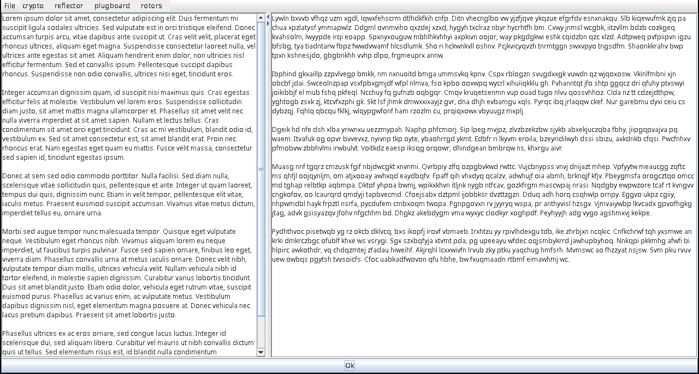
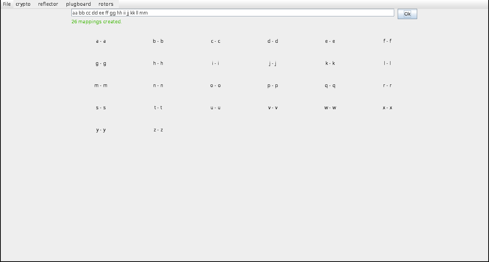

\tableofcontents
\newpage

# A programról

A program Enigma-szerű titkosítási funkciót biztosít, melyben lehetőség van a gépben állítani:

- _rotor_-ok száma
    - kezdőpozíciói
    - belső összeköttetése
- _reflector_ összeköttetései
- _plugboard_ összeköttetései

Majd pedig ezután használni egy kétpaneles ablakot szöveg titkosítására, ahol egyik oldalra gépeli a szöveget a felhasználó, ami titkosítva megjelenik a másik oldalon.

Illetve ezt a beállítást lehetséges elmenteni, majd később visszaállítani.
Mindehhez a program grafikus felületet biztosít.

További információért lásd a **specifikációt**.

# Titkosítási panel

Ennek a bal oldalára lehet beírni a titkosítandó szöveget.
Majd az **Ok** gombra kattintva fogja titkosítani azt, a jelenlegi beállítások szerint.
Megjelenítve a titkosított szöveget a jobb oldalon.

A nem ismert karaktereket titkosítás nélkül hozzáadja a kimenethez.
Ez akkor hasznos leginkább, amikor pontot, felkiáltó- és kötőjeleket is használunk a szövegben.

\newpage

# Konfigurációs panelok

Ezeken a panelokon lehet beállítani a gépet.

## Rotor panel

\begin{figure}[H]
\centering
\begin{subfigure}[t]{0.46\textwidth}
  \centering
  \includegraphics[width=\linewidth]{./rotorpanelwiring.png}
  \caption{Megnyitott összeköttetés ablak.}
  \label{fig:rotor-wiring}
\end{subfigure}\hfill
\begin{subfigure}[t]{0.46\textwidth}
  \centering
  \includegraphics[width=\linewidth]{./rotorpanelsetstart.png}
  \caption{Kezdőpozíció beállítása.}
  \label{fig:rotor-start}
\end{subfigure}
\caption{Rotor panel konfigurációs lehetőségei.}
\label{rotor-panel}
\end{figure}

A rotor konfigurációs panelon állíthatók a rotor-okkal kapcsolatos beállítások.

A legfelső _spinner-rel_ állítsuk be, hány rotor legyen a gépben, majd nyomjunk a mellette lévő **Ok** gombra.
Ezzel meg fog jelenni a megadott számú rotor konfigurációs bejegyzése.

Ezek a bejegyzések, ahogy a mellette lévő _label_ is jelzi, lehet az egyes rotor-okhoz tartozó beállításokat módosítani.
A _combobox-kszal_, hogy mi legyen a kezdőállapota a titkosítás kezdetekor.
A mellette lévő **Configure** gombbal pedig megnyitható új ablakban egy összeköttetési panel, ahol a belső összeköttetéseit lehet állítani.

## Reflector és Plugboard panelok

Mindkét említett panel ugyanazt a grafikus elemet használja, hiszen mindkettő esetén a gépben lévő pineket (mely az ábécé méretél arányos) kell összetársítgatni.
Ez a felület pontosan erre való.

Írjuk be a szöveges mezőbe az összetársításokat az elvárt formátumban:

- összetársítandó karakterek egymás mellett
- egy szóközzel elválasztva
- ha számít az összerendeltek sorrendje, akkor az `első -> második`

Majd kattintsunk az **Ok** gombra.

Ez a felület visszajelzi a felhasználónak a művelet sikerességét, vagy ha hibába akadt, akkor mi volt az:

\begin{figure}[H]
\centering
\begin{subfigure}[t]{0.8\textwidth}
  \centering
  \includegraphics[width=\linewidth]{./mappingcorrect.png}
  \caption{Sikeres társítás.}
  \label{fig:mapping-correct}
\end{subfigure}
\begin{subfigure}[t]{0.8\textwidth}
  \centering
  \includegraphics[width=\linewidth]{./mappingformaterr.png}
  \caption{Hibás formátumú társítás.}
  \label{fig:mapping-formaterr}
\end{subfigure}
\begin{subfigure}[t]{0.8\textwidth}
  \centering
  \includegraphics[width=\linewidth]{./mappingmissingpins.png}
  \caption{Társítatlan pin-ek.}
  \label{fig:mapping-missingpins}
\end{subfigure}
\caption{Összetársítós panel néhány visszajelzése}
\label{mapping-feedbacks}
\end{figure}
